# Laporan Praktikum Mingguan: Minggu 06 - Authentication, Security & Push Notifications

- **Nama**: Ghazwan Ababil
- **NIM**: 244107020151
- **Status Progres**: ✅ Selesai

---

## 1. Tujuan

- Menjelaskan alur autentikasi (Firebase Auth / JWT / OAuth) dan perbedaan ID token, access token, serta refresh token.
- Menyimpan token secara aman dengan `flutter_secure_storage` dan menerapkan refresh otomatis saat `401`.
- Menjelaskan arsitektur FCM (app server, Firebase, perangkat) dan mengelola token lifecycle (`getToken`, `onTokenRefresh`).
- Membedakan `notification` payload vs `data` payload serta perilakunya pada state foreground, background, dan terminated.
- Menangani klik notifikasi (deep link dengan GoRouter) dan topic messaging.
- Menerapkan prinsip keamanan dasar aplikasi mobile (tidak menyimpan secret di kode, tidak log token).

### Fitur Utama

- **Autentikasi & sesi**: login **Firebase Auth** (email + kata sandi), penyimpanan token aman, refresh otomatis satu kali saat `401`, dan logout yang membersihkan sesi.
- **Guard route**: pengguna tanpa token otomatis diarahkan ke `/login`; sesudah login diarahkan ke Home.
- **Push notification (FCM)**: permintaan izin, pengelolaan token (`getToken` + `onTokenRefresh`), pengiriman token ke backend (`POST /devices`).
- **Topic messaging**: langganan/berhenti berlangganan topik `pengumuman-kampus` dari Home.
- **Banner di tiga app state**: foreground (banner lokal manual), background & terminated (banner sistem), semuanya memakai channel `pengumuman` yang sama.
- **Deep link notifikasi**: klik banner membuka `/pengumuman/:id` via GoRouter pada ketiga state.
- **Halaman debug**: token FCM ditampilkan **terpotong** beserta tombol paksa refresh token.

### Stack Teknologi

- **Flutter/Dart** dengan **Riverpod 3** (`AsyncNotifier`, `NotifierProvider`) untuk manajemen state.
- **Firebase Auth** (email + kata sandi) untuk autentikasi nyata; ID token dipakai sebagai access token.
- **GoRouter** untuk navigasi deklaratif, guard route, dan deep link.
- **Dio** + interceptor untuk refresh token otomatis.
- **flutter_secure_storage** untuk penyimpanan token terenkripsi (Keystore/Keychain).
- **Firebase Core + Firebase Cloud Messaging** untuk push notification.
- **flutter_local_notifications** untuk banner manual saat foreground dan pembuatan notification channel.
- **Android** (minSdk 23, core library desugaring) sebagai target pengujian.

---

## 2. Langkah Praktikum

### Inisialisasi Project & Dependensi

Project dibuat langsung di dalam folder `06-week-6-authentication-security-fcm/` dengan nama package `campus_notify`, tanpa mengubah nama folder.

Perintah inisialisasi dan instalasi dependensi:

```bash
flutter create --project-name campus_notify --org com.example .
flutter pub add flutter_riverpod go_router dio flutter_secure_storage
flutter pub add firebase_core firebase_auth firebase_messaging flutter_local_notifications
```

Dependensi utama:

- `flutter_riverpod: ^3.4.3` (manajemen state reaktif dan `AsyncValue`).
- `go_router: ^18.0.2` (navigasi deklaratif + guard route + deep link).
- `dio: ^5.11.1` (HTTP client + interceptor refresh otomatis).
- `flutter_secure_storage: ^11.2.0` (penyimpanan token terenkripsi).
- `firebase_core: ^4.15.0` (inisialisasi Firebase).
- `firebase_auth: ^6.7.0` (autentikasi email + kata sandi; sumber ID token & refresh token).
- `firebase_messaging: ^16.7.0` (FCM: permission, token, handler).
- `flutter_local_notifications: ^22.3.1` (banner notifikasi manual saat foreground).

Struktur folder kerja:

```text
06-week-6-authentication-security-fcm/
├── docs/
│   └── ai_challenge.md
├── lib/
│   ├── main.dart
│   ├── routes.dart
│   ├── data/
│   │   ├── api_client.dart
│   │   ├── api_errors.dart
│   │   ├── auth_repository.dart
│   │   └── token_store.dart
│   ├── messaging/
│   │   └── push_service.dart
│   ├── providers/
│   │   ├── auth_provider.dart
│   │   └── push_provider.dart
│   └── pages/
│       ├── login_page.dart
│       ├── home_page.dart
│       └── announcement_page.dart
├── test/
│   └── auth_push_test.dart
├── screenshots/
└── README.md
```

---

## 3. Implementasi Fitur & AI Challenge

### Praktikum 1: Autentikasi & Keamanan Token

1. **Penyimpanan Token Aman (`lib/data/token_store.dart`)**
   - `TokenStore` membungkus `flutter_secure_storage` (Keychain/Keystore). Seluruh token hanya keluar-masuk lewat kelas ini.
   - Access dan refresh token disimpan dengan key terpisah; `clear()` menghapus semuanya saat logout.

2. **Repository Auth dengan Firebase Auth (`lib/data/auth_repository.dart`)**
   - `AuthRepository.login()` memverifikasi kredensial lewat **Firebase Auth** (`signInWithEmailAndPassword`) — sudah dieksekusi (mock diganti implementasi nyata).
   - `access` = **ID token** Firebase (JWT berumur pendek) → dikirim sebagai `Authorization: Bearer ...`.
   - `refresh` = penanda sesi. Catatan: di Android/iOS `User.refreshToken` **kosong** karena SDK Firebase mengelola refresh token secara internal; penukaran ID token baru dilakukan via `user.getIdToken(true)` pada `refresh()`.
   - Backend dibungkus abstraksi `AuthBackend` agar `AuthRepository` dapat diuji tanpa Firebase (unit test memakai `FakeAuthBackend`).

3. **Dio dengan Refresh Otomatis (`lib/data/api_client.dart`)**
   - Interceptor `onRequest` menyisipkan header `Authorization: Bearer <access>`.
   - Interceptor `onError` mencoba refresh **satu kali** saat menerima `401`, lalu mengulang request; bila refresh gagal, token dibersihkan (paksa login ulang).

4. **Provider Auth + Guard Route (`lib/providers/auth_provider.dart`, `lib/main.dart`)**
   - `authStateProvider` (`AsyncNotifier<bool>`) membaca status login dari keberadaan token.
   - `redirect` GoRouter mengarahkan pengguna yang belum login ke `/login` dan sebaliknya; `refreshListenable` memicu evaluasi ulang saat status auth berubah.

5. **Halaman (`lib/pages/`)**
   - `LoginPage` (form email/kata sandi), `HomePage` (tombol logout, contoh deep link, kartu token debug + paksa refresh, dan switch langganan topik), serta `AnnouncementPage` (tujuan rute `/pengumuman/:id`).

> Catatan build Android: `flutter_local_notifications` memerlukan **core library desugaring** dan `minSdk = 23`. Perubahan dilakukan pada `android/app/build.gradle.kts` (folder `android/` tidak di-commit sesuai aturan repo).

### Praktikum 2: Firebase Cloud Messaging (FCM)

1. **Integrasi Firebase (`lib/main.dart`)**
   - `Firebase.initializeApp()` dipanggil sebelum `runApp`. Aplikasi Android terdaftar di project Firebase `campus-notify-9856f` dengan package `com.example.campus_notify`; plugin `com.google.gms.google-services` diterapkan di Gradle.

2. **`PushService` (`lib/messaging/push_service.dart`)**
   - `requestNotificationPermission()` meminta izin runtime (wajib di Android 13+/iOS).
   - `initFcmToken()` mengambil token via `getToken()`, memantau perubahan via `onTokenRefresh.listen(onToken)`, dan berlangganan topik `pengumuman-kampus` (`subscribeCampusTopic()`). Token dikirim ke backend melalui `POST /devices` (`{fcm_token, platform}`).
   - `subscribeCampusTopic()` / `unsubscribeCampusTopic()` membungkus `subscribeToTopic` / `unsubscribeFromTopic`; pengguna dapat mengubah langganan topik dari Home.
   - `initLocalNotifications()` membuat **notification channel** `pengumuman` (`AndroidNotificationChannel`, importance high) di Android 8+, dan channel yang sama diset sebagai default FCM lewat `com.google.firebase.messaging.default_notification_channel_id` di `AndroidManifest.xml`. Dengan begitu banner foreground, background, dan terminated tampil konsisten (tanpa ini, background/terminated memakai `fcm_fallback_notification_channel`).
   - `firebaseMessagingBackgroundHandler()` adalah fungsi **top-level** ber-`@pragma('vm:entry-point')` dan tidak mengakses `BuildContext`/Riverpod (berjalan di isolate terpisah).
   - `listenForeground()` menampilkan banner **manual** lewat `flutter_local_notifications` saat `onMessage` (sistem tidak menampilkan otomatis di foreground), dan menangani `onMessageOpenedApp` untuk klik saat background.
   - `handleTerminated()` membaca `getInitialMessage()` untuk membuka rute dari notifikasi saat aplikasi dimatikan.

3. **Tampilan token debug (`lib/pages/home_page.dart`, `lib/providers/push_provider.dart`)**
   - Token FCM ditampilkan **terpotong** (12 karakter pertama + `...`) pada kartu "Token FCM (debug)", bersama nama topik yang di-subscribe.
   - Tersedia tombol **paksa refresh token** (memanggil `deleteToken()` lalu `getToken()`) untuk membuktikan token terbaru dikirim ulang ke backend.
   - Tersedia **switch langganan topik** `pengumuman-kampus` yang memanggil `subscribeCampusTopic()` / `unsubscribeCampusTopic()`.

4. **Refactoring (`lib/routes.dart`, `lib/data/api_errors.dart`)**
   - String rute dipusatkan di `Routes`; parsing `data` payload diekstrak ke fungsi murni `routeFromMessage()`; pemetaan `DioException` ke pesan pengguna dipindah ke `friendlyApiError()`.

### Tabel Pengujian Tiga App State (Wajib)

Payload uji (gabungan `notification` + `data`):

```json
{
  "message": {
    "topic": "pengumuman-kampus",
    "notification": {
      "title": "Jadwal kuliah berubah",
      "body": "Kelas Mobile pindah ke Ruang A2 jam 13.00"
    },
    "data": { "route": "/pengumuman/3", "id": "3" }
  }
}
```

| State      | Yang Diharapkan                                             | Cara Uji                         | Hasil | Bukti      |
| :--------- | :---------------------------------------------------------- | :------------------------------- | :---: | :--------- |
| Foreground | Banner lokal muncul, klik masuk ke `/pengumuman/3`          | Aplikasi terbuka, kirim pesan    |  ✅   | `05`, `06` |
| Background | Banner sistem muncul, klik masuk ke rute yang benar         | Tekan Home, kirim, klik banner   |  ✅   | `07`, `08` |
| Terminated | Aplikasi terbuka ke rute yang benar via `getInitialMessage` | Tutup proses, kirim, klik banner |  ✅   | `09`, `10` |

> Catatan: saat aplikasi terminated, logcat menunjukkan `[FCM] getInitialMessage ... route=/pengumuman/3` dan aplikasi cold start langsung ke halaman detail pengumuman.

### Uji Token Lifecycle (Wajib Dibuktikan)

Langkah: catat token awal, lalu **hapus data aplikasi** (`adb shell pm clear com.example.campus_notify`) dan buka ulang.

| Kondisi                       | Token (terpotong) | Bukti |
| :---------------------------- | :---------------- | :---: |
| Sebelum clear data            | `dE0wJWTKR4e4...` | `04`  |
| Setelah clear data + relaunch | `eB2MdOBRSKWc...` | `11`  |

Setelah clear data, logcat menunjukkan `[FCM] token dikirim ke backend: eB2MdOBRSKWc...` — token **berubah** dan otomatis dikirim ulang ke backend. Inilah alasan `onTokenRefresh` wajib dipasang: tanpa itu, backend menyimpan token lama yang sudah tidak valid.

### Uji Topic Messaging (subscribe / unsubscribe)

| Aksi                                        | Kirim ke topik      | Hasil                         | Bukti |
| :------------------------------------------ | :------------------ | :---------------------------- | :---: |
| Topik **nonaktif** (`unsubscribeFromTopic`) | `pengumuman-kampus` | Tidak ada notifikasi diterima | `12`  |
| Topik **aktif** (`subscribeToTopic`)        | `pengumuman-kampus` | Notifikasi diterima           | `13`  |

### Konsistensi Channel Notifikasi

Sebelum perbaikan, banner background/terminated memakai `fcm_fallback_notification_channel` (bawaan FCM) sehingga berbeda dengan foreground. Setelah channel `pengumuman` dibuat dan diset sebagai default FCM, `dumpsys notification` menunjukkan channel `pengumuman` dipakai di background (bukti `14`).

### Uji Kirim Pertama (Setara `fcm-console-test.png`)

Mengirim notifikasi pertama dari **Firebase Console** dan menyimpannya sebagai `screenshots/fcm-console-test.png`. Pada praktikum ini pengiriman dilakukan lewat **FCM HTTP v1** (`POST /v1/projects/campus-notify-9856f/messages:send`) dengan payload JSON yang identik dengan yang dikirim Console/backend:

Hasil (banner sistem saat aplikasi background) disimpan sebagai `screenshots/fcm-console-test.png`.

> **Catatan deviasi:** Console tidak dipakai karena Firebase CLI sedang logout dan Console memerlukan login browser. FCM HTTP v1 memakai jalur server yang sama dengan Console (keduanya berakhir di FCM API), sehingga perilaku banner identik; perbedaannya hanya pada antarmuka pengiriman.

### Uji Firebase Auth

| Sebelum                              | Sesudah                                                                      |
| :----------------------------------- | :--------------------------------------------------------------------------- |
| Mock JWT (`mock-access-for-<email>`) | `FirebaseAuth.signInWithEmailAndPassword` (kredensial diverifikasi Firebase) |
| Access = string simulasi             | Access = **ID token** Firebase                                               |
| Refresh = string simulasi            | Refresh = penanda sesi; ID token baru via `getIdToken(true)`                 |

Bukti (user uji `mahasiswa@polinema.ac.id`): login → Home (`16`), sesi bertahan setelah restart (`15`), logout → `/login` (`17`). Logcat: `FirebaseAuth: Notifying auth state listeners about user (PTFi3...Q93)`.

> **Prasyarat**: provider **Email/Password** harus diaktifkan di Firebase Console (Authentication → Sign-in method) dan minimal satu user uji dibuat. Tanpa itu, login gagal dengan `CONFIGURATION_NOT_FOUND`.

### Verifikasi Tabel "Error Umum dan Solusinya"

| Kendala                                             | Penanganan di project ini                                                                                                 |      Status      |
| :-------------------------------------------------- | :------------------------------------------------------------------------------------------------------------------------ | :--------------: |
| Token null di emulator                              | Emulator dipakai yang punya **Google Play Services**; token berhasil diperoleh (`eB2MdOBRSKWc...`).                       | ✅ terverifikasi |
| Banner tidak muncul saat foreground                 | Ditampilkan **manual** via `flutter_local_notifications` di `onMessage` (bukti `05`).                                     | ✅ terverifikasi |
| Klik notifikasi tidak navigasi (terminated)         | `handleTerminated()` dipanggil saat startup sebelum tugas berat (bukti `10`).                                             | ✅ terverifikasi |
| 401 berulang meski sudah login                      | Interceptor refresh **sekali** lalu retry; bila refresh mati → `clear()` + ke `/login` (unit test).                       | ✅ terverifikasi |
| `MissingPluginException` (secure storage/messaging) | Setiap tambah plugin selalu **full restart** `flutter run`; tidak muncul exception, token FCM & secure storage berfungsi. | ✅ terverifikasi |
| Notifikasi iOS tidak muncul                         | Project **Android-only**; APNs tidak dikonfigurasi.                                                                       |      ⚠️ N/A      |

### Bukti Visual Implementasi (Screenshots)

|                              Bukti Tampilan                              | Deskripsi Antarmuka                                                                                                       |
| :----------------------------------------------------------------------: | :------------------------------------------------------------------------------------------------------------------------ |
|             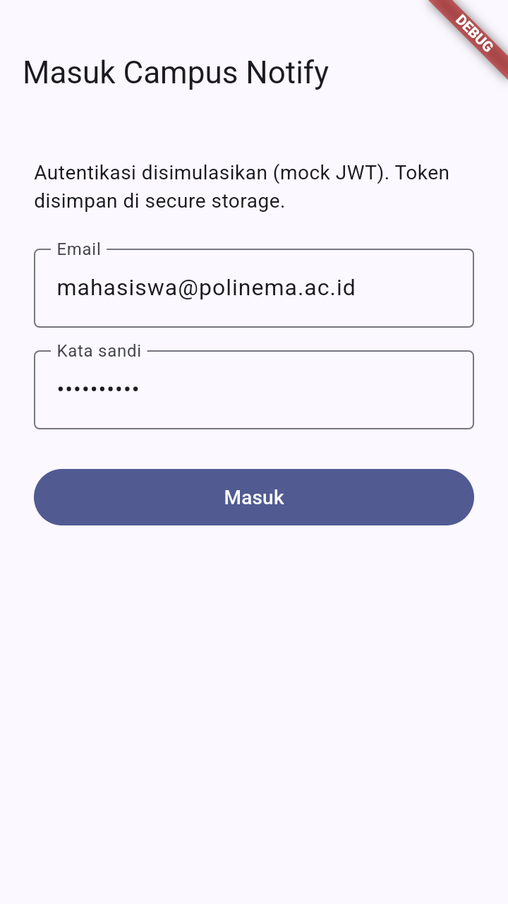             | **Guard Route**: tanpa token, aplikasi otomatis diarahkan ke `/login`.                                                    |
|       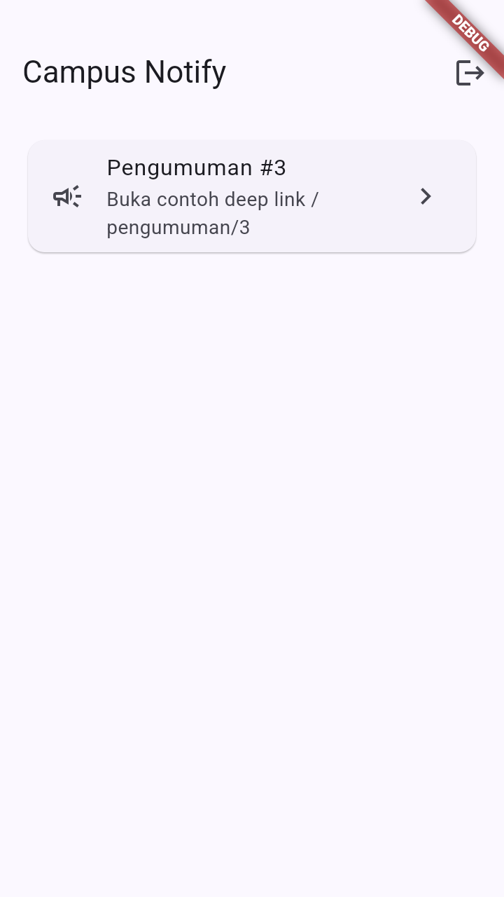       | **Login Berhasil**: setelah kredensial valid, token tersimpan di secure storage dan masuk ke `/`.                         |
|        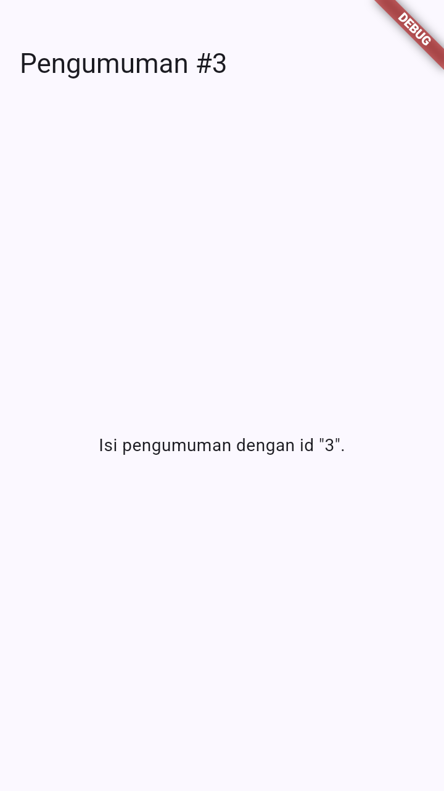         | **Deep Link `/pengumuman/3`**: rute tujuan notifikasi dibuka dengan benar.                                                |
|         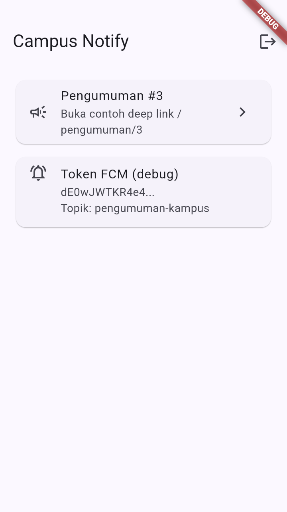         | **Token FCM (debug)**: token ditampilkan terpotong (`dE0wJWTKR4e4...`) beserta topik `pengumuman-kampus`.                 |
| 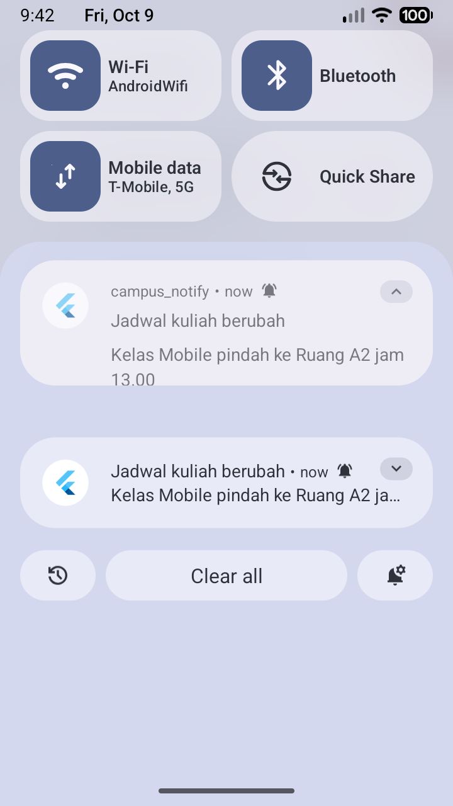 | **Foreground**: banner lokal tampil dari `onMessage` (tampil manual).                                                     |
|         | **Foreground klik**: masuk ke `/pengumuman/3`.                                                                            |
| 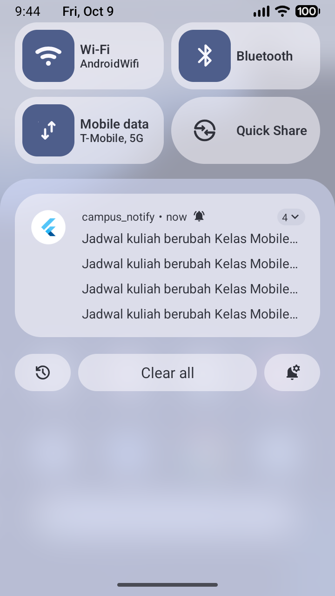 | **Background**: banner sistem muncul otomatis.                                                                            |
|    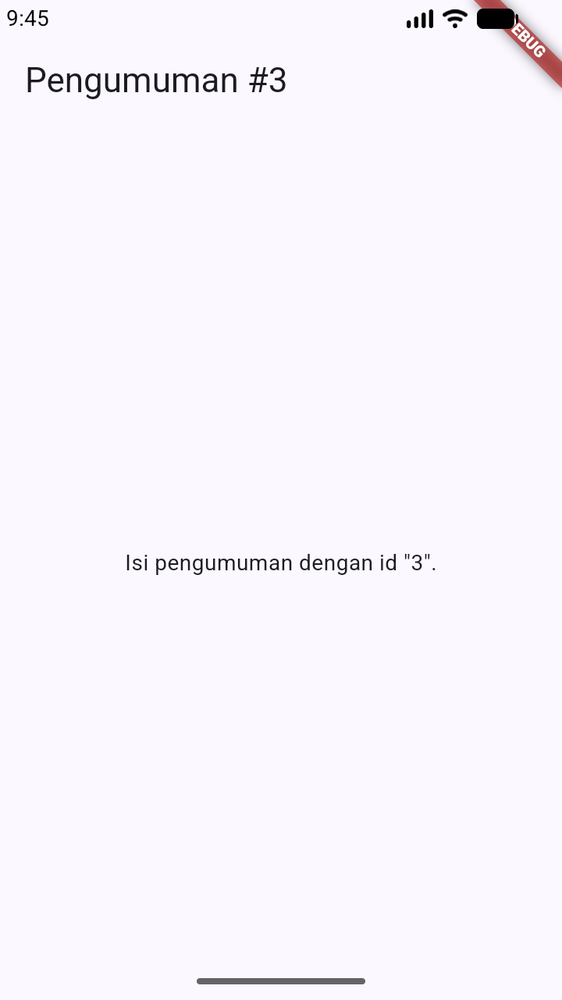     | **Background klik**: aplikasi dibuka ke `/pengumuman/3`.                                                                  |
| 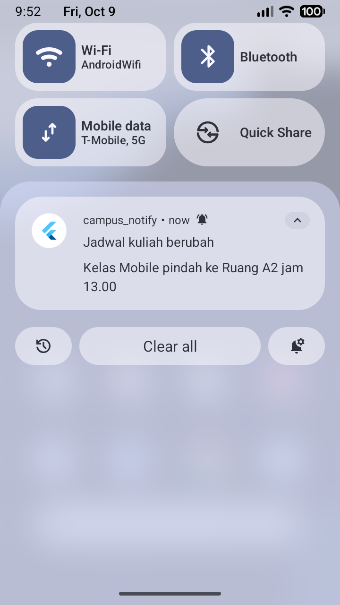 | **Terminated**: notifikasi sistem tersedia saat aplikasi dimatikan.                                                       |
|    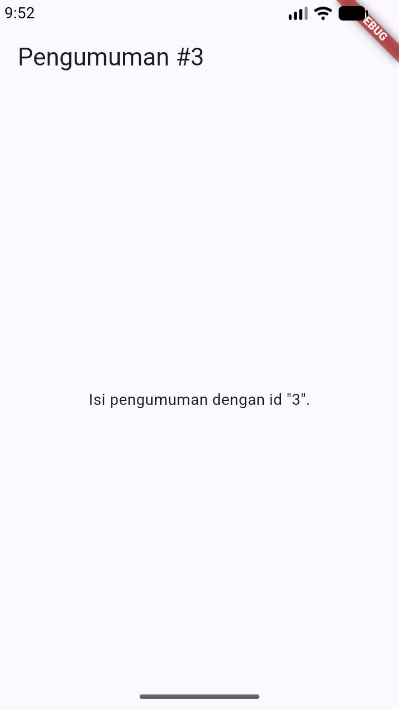     | **Terminated klik**: cold start ke `/pengumuman/3` via `getInitialMessage`.                                               |
| 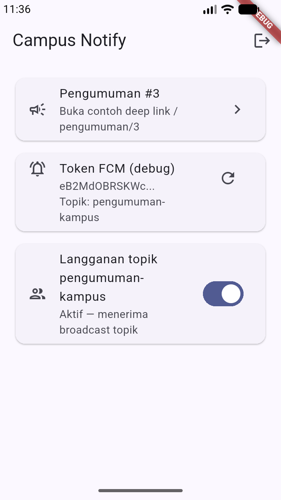 | **Token lifecycle**: setelah clear data, token berubah menjadi `eB2MdOBRSKWc...` dan terkirim ulang ke backend.           |
|       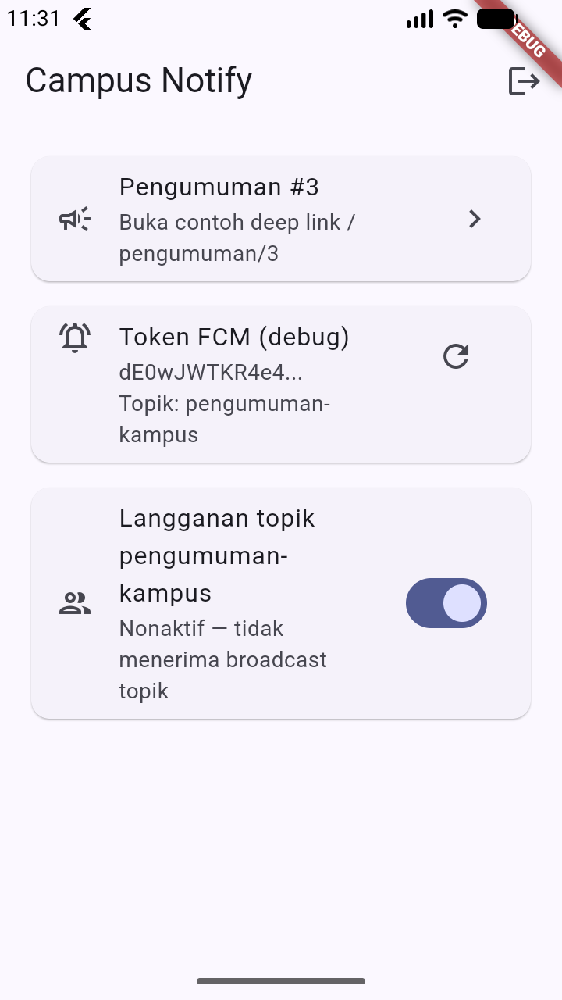       | **Unsubscribe topik**: switch nonaktif, perangkat tidak lagi menerima broadcast topik.                                    |
|       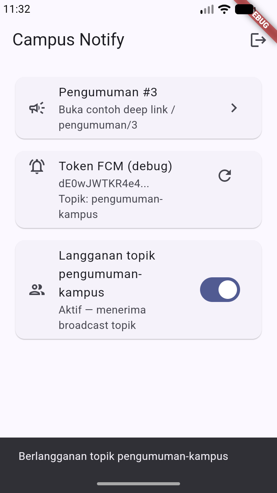       | **Resubscribe topik**: switch aktif kembali, broadcast topik diterima lagi.                                               |
|  | **Konsistensi channel**: banner background memakai channel `pengumuman` yang sama dengan foreground.                      |
|             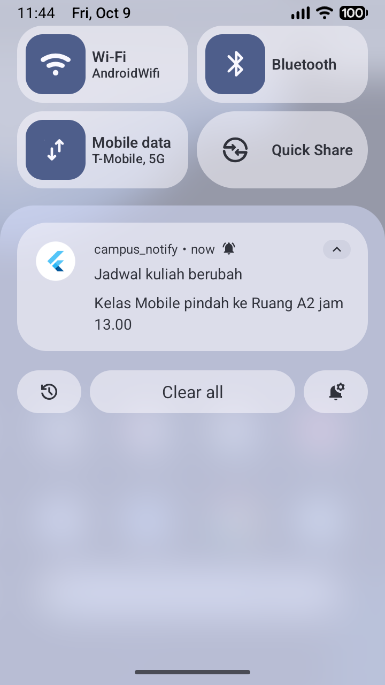             | **Uji kirim pertama** : banner sistem saat background dari payload `notification + data` via FCM HTTP v1.                 |
|       | **Login Firebase Auth**: kredensial diverifikasi Firebase, masuk ke Home.                                                 |
|   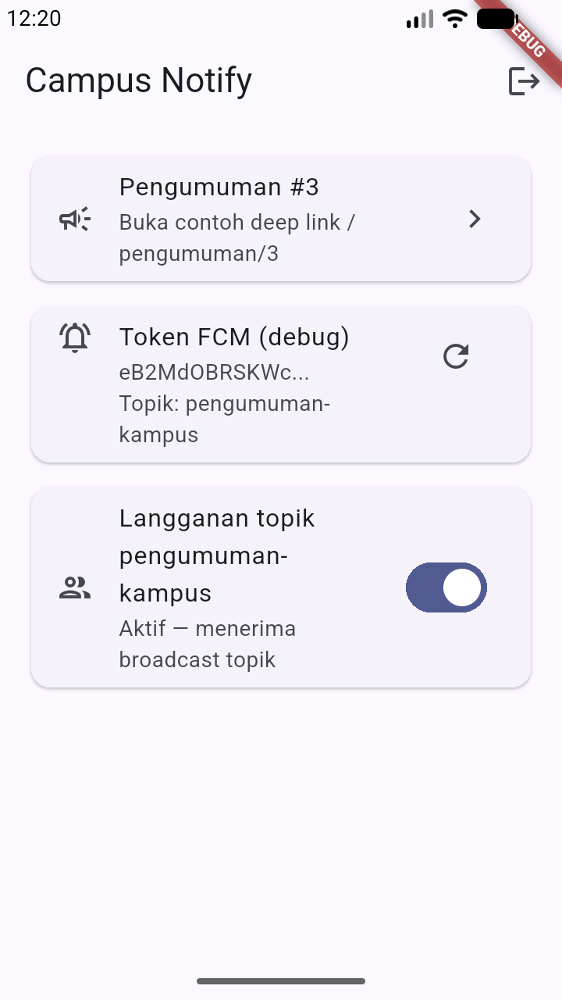   | **Persistensi sesi**: setelah force-stop, token di secure storage membuat app langsung ke Home (tidak perlu login ulang). |
|             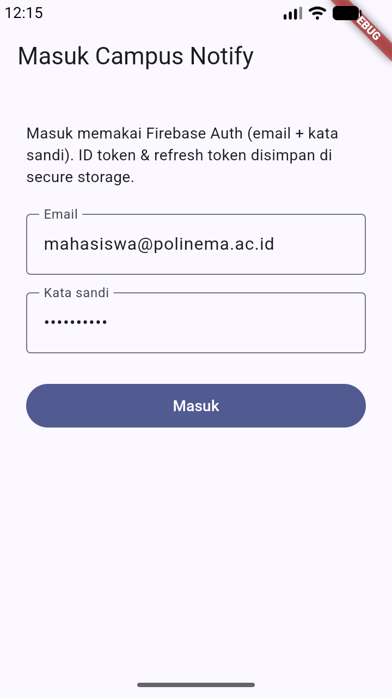              | **Logout**: `signOut()` Firebase + token lokal dibersihkan, kembali ke `/login`.                                          |

> Catatan: screenshot diambil langsung dari emulator Android (720×1280) dalam mode debug.

### AI Challenge

Ringkasan lengkap (prompt, output awal AI, checklist verifikasi, perbaikan manual, dan keputusan teknis) ada di [`docs/ai_challenge.md`](./docs/ai_challenge.md). Poin terpenting:

- **Perbaikan manual kritis**: draf AI hanya menyimpan `pendingDeepLink` saat tap banner foreground tanpa navigasi langsung → ditambahkan callback `onSelect`.
- **Bug nyata yang hanya terlihat saat diuji**: urutan inisialisasi membuat `getInitialMessage()` terlewat saat cold start → deep link terminated gagal; diperbaiki dengan mendaftarkan handler lebih dulu.
- **Keamanan**: token tidak pernah ditampilkan penuh atau dicatat ke log; `google-services.json` dikecualikan dari Git.

### Pengujian Otomatis

`flutter test` menjalankan 12 test (semua lulus): parsing rute `routeFromMessage`, logika sesi/refresh (`401` → refresh sekali → retry; refresh mati → sesi dibersihkan), pemetaan `DioException` (`friendlyApiError`), dan pemetaan galat Firebase Auth (`friendlyAuthError`). `flutter analyze` bersih.

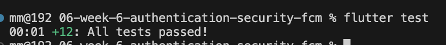

### Cara Menjalankan

```bash
flutter pub get
flutter analyze
flutter test
flutter run           # jalankan di emulator/perangkat
```

Untuk login, aktifkan **Authentication → Sign-in method → Email/Password** di Firebase Console dan buat user test. Untuk menguji notifikasi, kirim payload gabungan `notification + data` ke topik `pengumuman-kampus` atau ke token perangkat.

---

## 4. Refleksi

1. **Mengapa refresh token tidak boleh disimpan di SharedPreferences? Apa risikonya bila bocor?**
   SharedPreferences menyimpan data dalam bentuk plaintext di penyimpanan internal aplikasi. Pada perangkat yang di-root, backup yang tidak terenkripsi, atau eksploitasi pembacaan berkas, refresh token bisa dibaca pihak lain. Refresh token berumur panjang (mis. 7 hari) dan dapat menukar access token baru tanpa login, sehingga bila bocor penyerang bisa mengakses akun dalam waktu lama tanpa perlu mengetahui kata sandi. Karena itu token hanya disimpan di `flutter_secure_storage` yang memakai Keystore (Android) / Keychain (iOS).

2. **Apa yang rusak bila `onTokenRefresh` diabaikan selama satu semester perkuliahan?**
   Token FCM berubah saat aplikasi di-reinstall, data dibersihkan, aplikasi dipulihkan dari backup, atau token dirotasi Firebase. Tanpa listener `onTokenRefresh`, backend menyimpan token lama yang sudah tidak valid. Akibatnya push notification tidak sampai ke perangkat pengguna — kegagalan senyap, karena pengiriman dari sisi server tampak "berhasil" tetapi tidak ada perangkat yang menerima. Sepanjang satu semester, seluruh pengumuman penting berpotensi tidak terkirim.

3. **Kapan memakai topik dan kapan memakai token perangkat?**
   - **Topik** untuk broadcast ke banyak pengguna sekaligus tanpa perlu tahu daftar token. Contoh: pengumuman jadwal kuliah, libur nasional, atau info UKM untuk seluruh mahasiswa.
   - **Token perangkat** untuk pesan personal yang hanya boleh diterima satu pengguna. Contoh: nilai ujian, tagihan UKT, atau pengingat pembayaran yang spesifik milik satu mahasiswa.

4. **Bagian mana dari draf AI yang Anda tolak atau perbaiki, dan mengapa?**
   Dua hal utama: (a) draf AI hanya menyimpan `pendingDeepLink` saat tap banner foreground tanpa memicu navigasi, sehingga tap tidak membuka rute — ditambahkan callback `onSelect`; (b) urutan inisialisasi FCM menyebabkan `getInitialMessage()` terlewat saat cold start dari notifikasi, sehingga deep link terminated gagal — dipindahkan pendaftaran handler ke sebelum tugas berat.

---

## 5. Jurnal Belajar

### Ringkasan Teknis

- Memahami tiga jenis token (ID, access, refresh) dan pola penyimpanan aman di secure storage.
- Menerapkan refresh otomatis satu kali pada `401` lewat interceptor Dio, dengan fallback logout bila refresh ikut kedaluwarsa.
- Memahami perbedaan perilaku `notification` vs `data` payload pada tiga app state, dan mengapa aplikasi notifikasi kampus selalu memakai gabungan keduanya.
- Mengelola token lifecycle FCM: `getToken`, `onTokenRefresh`, `subscribeToTopic`/`unsubscribeFromTopic`, serta handler top-level untuk background isolate.
- Menangani deep link notifikasi ke GoRouter untuk foreground (`onMessage` + local notification), background (`onMessageOpenedApp`), dan terminated (`getInitialMessage`).
- Membuat notification channel Android eksplisit dan menyetelnya sebagai channel default FCM agar banner konsisten di semua app state.
- Melakukan refactoring (konstanta rute, fungsi murni, pemetaan error) agar logika dapat diunit-test tanpa Firebase.

### Kendala

- **Bug deep link terminated**: percobaan pertama cold start mendarat di Home, bukan `/pengumuman/3`. Ditemukan lewat logcat dan diperbaiki dengan mengubah urutan inisialisasi.
- **Emulator & state**: `am force-stop` menaruh aplikasi pada _stopped state_ sehingga FCM tidak terkirim; state terminated yang benar disimulasikan dengan mematikan proses dari background (`am kill`) sehingga notifikasi tetap masuk.
- **Channel notifikasi tidak konsisten**: banner background/terminated semula memakai `fcm_fallback_notification_channel` bawaan FCM, berbeda dengan foreground. Ditemukan lewat `dumpsys notification` dan diperbaiki dengan membuat channel `pengumuman` + `default_notification_channel_id`.
- **`refreshToken` kosong di Android**: login Firebase Auth berhasil tetapi kode menampilkan "Gagal memperoleh token". Ternyata `User.refreshToken` **kosong** di Android/iOS (hanya web yang mengembalikannya). Diperbaiki: `access` = ID token, `refresh` = uid sebagai penanda sesi, dan penukaran ID token via `getIdToken(true)`.

---

## 6. Kesimpulan

Praktikum Minggu 06 berhasil membangun **Campus Notification App** dengan autentikasi berlapis dan push notification end-to-end. Login memakai **Firebase Auth** (email + kata sandi) — dengan ID token disimpan aman di `flutter_secure_storage`, Dio melakukan refresh otomatis satu kali saat `401` dan memaksa login ulang bila refresh mati, serta FCM terintegrasi lengkap (permission, `getToken`/`onTokenRefresh` → `POST /devices`, topik `pengumuman-kampus` + unsubscribe, background handler top-level, channel notifikasi konsisten). Ketiga app state — foreground, background, dan terminated — terbukti nyata membuka rute `/pengumuman/3` dari notifikasi gabungan `notification + data`, didukung 12 test yang lulus dan `flutter analyze` yang bersih. Pelajaran terpenting: perilaku FCM dan token tidak cukup diverifikasi dari membaca kode; beberapa bug (tap foreground, deep link terminated, channel tidak konsisten, `refreshToken` kosong di Android) hanya muncul saat diuji di perangkat dan diperbaiki berdasarkan bukti log.
