# Laporan Praktikum Mingguan: Minggu 07 - Clean Architecture in Flutter

- **Nama**: Ghazwan Ababil
- **NIM**: 244107020151
- **Status Progres**: ✅ Selesai

---

## 1. Tujuan

- Menjelaskan prinsip SOLID dan separation of concerns dengan contoh kode Flutter.
- Membedakan struktur feature-first vs layer-first beserta trade-off-nya.
- Menjelaskan tiga layer (presentation, domain, data) dan aturan dependensi (dependensi mengarah ke dalam).
- Membedakan entity vs model serta peran repository, use case, dan dependency injection.
- Merefactor project Minggu 5 menjadi struktur feature-first yang terpisah layer-nya.
- Menguji use case dengan repository palsu tanpa database atau jaringan sungguhan.

---

## 2. Persiapan & Dasar Refactor

Codelab Minggu 7 **merefactor project yang sudah ada**, bukan membuat dari nol. Project sumber yang dipakai adalah **Minggu 5 (`week5_offline_notes`)** — sesuai pilihan "gunakan folder Week 5" — lalu hasil refactor ditempatkan pada folder baru **`07-week-7-clean-architecture/`**.

Perintah yang dijalankan:

```bash
# 1) Salin project Minggu 5 sebagai basis (tanpa artefak build)
rsync -a --exclude build/ --exclude .dart_tool/ --exclude .idea/ \
  05-week-5-local-storage-offline-first/ 07-week-7-clean-architecture/

# 2) Ganti identitas package menjadi week7_clean_architecture
#    (pubspec.yaml, android namespace/applicationId, MainActivity)

# 3) Verifikasi baseline SEBELUM refactor
cd 07-week-7-clean-architecture
flutter pub get && flutter analyze && flutter test
```

Baseline sebelum refactor: `flutter analyze` bersih dan `flutter test` **4/4 lulus**. Snapshot ini adalah kondisi "before" yang bisa dibandingkan (project Minggu 5 juga sudah ter-commit, sehingga rollback selalu mungkin).

Struktur folder kerja:

```text
07-week-7-clean-architecture/
├── docs/
│   └── ai_challenge.md
├── lib/            # hasil refactor feature-first (lihat §4)
├── test/           # 11 tes
├── screenshots/    # bukti before/after
├── README.md
└── pubspec.yaml    # package: week7_clean_architecture
```

---

## 3. Praktikum 1 — Memetakan File ke Layer

### 3.1 Tabel pemetaan file → layer (kondisi awal Week 5)

| File (Week 5)                                                   | Layer saat ini            | Masalah                                                                           |
| :-------------------------------------------------------------- | :------------------------ | :-------------------------------------------------------------------------------- |
| `pages/notes_page.dart`                                         | presentation              | Mengimpor `data/*` langsung dan memanggil repository; berisi dialog & banner      |
| `pages/note_detail_page.dart`                                   | presentation              | Mengimpor `data/local/note.dart` dan `data/repositories/*`                        |
| `pages/posts_page.dart`                                         | presentation              | Mengimpor `data/sync.dart`                                                        |
| `pages/settings_page.dart`                                      | presentation              | **Provider & notifier didefinisikan di file halaman**; `DateTime.tryParse` inline |
| `widgets/note_tile.dart`                                        | presentation              | Bergantung pada entity yang tercampur mapping (`data/local/note.dart`)            |
| `widgets/offline_toggle.dart`                                   | presentation              | Mengimpor `data/sync.dart`                                                        |
| `main.dart`                                                     | presentation              | `PrefsRepository()` diinstansiasi manual (DI bocor)                               |
| `data/local/note.dart`                                          | data (+entity)            | Entity **tercampur mapping** (`toMap`/`fromMap`)                                  |
| `data/models/post.dart`                                         | data (+entity)            | Entity + mapping `fromJson`/`toJson` dalam satu kelas                             |
| `data/repositories/note_repository.dart`                        | data (+kontrak tercampur) | Kelas konkret tanpa interface; provider + notifier menempel di file yang sama     |
| `data/sync.dart`                                                | data **+ presentation**   | Campur: provider, notifier, baca/tulis cache, `jsonDecode`, logika sync           |
| `data/prefs.dart`, `data/api_client.dart`, `data/local/db.dart` | data                      | Cukup wajar (hanya perlu ditata ke layer)                                         |
| `utils/date_format.dart`                                        | util                      | dipindah ke `lib/core/format.dart`                                                |

### 3.2 Tiga pelanggaran klasik (temuan awal, sebelum refactor)

```bash
# (1) Widget menyentuh jaringan/database langsung
rg "Dio\(|http\.|openDatabase|SharedPreferences\.getInstance|FlutterSecureStorage" lib/pages lib/widgets
# → 0 di pages/widgets (belum bocor), tetapi pages/widgets tetap mengimpor data/*

# (2) Logika bisnis di dalam build()
rg "DateFormat|jsonDecode|\.toIso8601String" lib/pages lib/widgets
# → pages/settings_page.dart: DateTime.tryParse inline (formatting di presentation)

# (3) Instansiasi manual (DI bocor)
rg "Repository\(|Dio\(BaseOptions" lib/pages lib/providers
# → main.dart:13 PrefsRepository(); settings_page.dart:6 provider dibuat di file halaman
```

Kesimpulan awal: pelanggaran utama Week 5 bukan widget→Dio, melainkan **(a) presentation mengimpor `data/` langsung, (b) entity tercampur mapping, (c) kontrak & implementasi repository menyatu, (d) wiring DI tersebar, (e) util belum menjadi `core/`.**

### 3.3 Struktur target (feature-first)

```text
lib/
├── core/
│   ├── failures.dart          # Failure domain (murni Dart)
│   ├── format.dart            # formatDateTime, parseStoredDateTime, parseNoteId
│   └── routes.dart            # konstanta rute (murni, tanpa import Flutter)
├── shared/                    # infrastruktur lintas fitur
│   ├── data/app_database.dart # openAppDb (satu file DB: notes + cached_posts)
│   ├── providers/offline_provider.dart
│   └── widgets/offline_toggle.dart
├── features/
│   ├── notes/
│   │   ├── domain/  (entities/note.dart, repositories/note_repository.dart, usecases/)
│   │   ├── data/    (models/note_model.dart, repositories/note_repository_impl.dart)
│   │   └── presentation/ (providers/, pages/, widgets/)
│   ├── posts/
│   │   ├── domain/  (entities/post.dart, repositories/posts_repository.dart)
│   │   ├── data/    (models/post_model.dart, api_client.dart, repositories/)
│   │   └── presentation/ (providers/, pages/)
│   └── settings/
│       ├── domain/repositories/prefs_repository.dart
│       ├── data/repositories/prefs_repository_impl.dart
│       └── presentation/ (providers/, pages/)
├── routes.dart                # GoRouter
└── main.dart
```

---

## 4. Praktikum 2 — Membangun Layer

### 4.1 Entity murni (domain)

`lib/features/notes/domain/entities/note.dart` — tanpa import Flutter, tanpa `toMap`/`fromMap`/`toJson`:

```dart
class Note {
  const Note({
    this.id,
    required this.title,
    this.body = '',
    required this.updatedAt,
    this.dirty = false,
  });

  final int? id;
  final String title;
  final String body;
  final DateTime updatedAt;
  final bool dirty;
}
```

### 4.2 Failure & kontrak repository (domain)

`lib/core/failures.dart` (sealed, murni Dart) dan `lib/features/notes/domain/repositories/note_repository.dart`:

```dart
abstract class NoteRepository {
  Future<({List<Note> notes, Failure? failure})> fetchNotes();
  Future<({Note? note, Failure? failure})> addNote({required String title, String body});
  Future<({Note? note, Failure? failure})> fetchNoteById(int id);
  Future<Failure?> deleteNote(int id);
  Future<({int count, Failure? failure})> countDirty();
  Future<Failure?> markAllSynced();
}
```

Memakai **record** agar sukses/gagal eksplisit tanpa exception bocor ke presentation.

### 4.3 Model & implementasi (data)

`lib/features/notes/data/models/note_model.dart` (`extends Note`, satu-satunya tempat `toMap`/`fromMap`/`toEntity`) dan `lib/features/notes/data/repositories/note_repository_impl.dart` (SQLite; `openDb` disuntikkan lewat constructor agar mudah diganti fake).

### 4.4 Use case

- `domain/usecases/get_notes.dart` — `GetNotes` (contoh dari modul).
- `domain/usecases/sync_notes.dart` — `SyncNotes`, contoh use case yang **memang** perlu karena menggabungkan beberapa langkah (hitung `dirty` → kirim → tandai tersinkron).

> **Keputusan:** `addNote`/`deleteNote`/`fetchNoteById` adalah CRUD satu-baris dan **tidak** dibuatkan use case (cukup repository → notifier) untuk menghindari over-engineering. Alasan lengkap ada di [docs/ai_challenge.md](./docs/ai_challenge.md).

---

## 5. Praktikum 3 — Wiring DI & Halaman

### 5.1 DI terpusat (Riverpod, tanpa package DI tambahan)

`lib/features/notes/presentation/providers/notes_providers.dart`:

```dart
final noteRepositoryProvider = Provider<NoteRepository>(
  (ref) => NoteRepositoryImpl(openDb: openAppDb),
);
final getNotesProvider = Provider<GetNotes>(
  (ref) => GetNotes(ref.watch(noteRepositoryProvider)),
);
final syncNotesProvider = Provider<SyncNotes>(
  (ref) => SyncNotes(ref.watch(noteRepositoryProvider)),
);
```

Halaman hanya membaca state (`ref.watch(notesProvider)`) dan tidak pernah `new Repository()`.

### 5.2 Diagram layer + arah dependensi

```text
presentation (widget, notifier, router)   features/*/presentation
      |
      v  bergantung ke (abstraksi)
domain (entity, repository interface, use case, failure)   features/*/domain, core/
      ^
      |  diimplementasikan oleh
data (model, repository impl, Dio, SQLite, SharedPreferences)   features/*/data, shared/data
```

Aturan emas: **dependensi hanya mengarah ke dalam**. `domain` tidak tahu Flutter, Dio, SQLite, atau Firebase.

### 5.3 Verifikasi dependency rule — tiga grep sterilitas

```bash
# (1) Presentation steril dari data mentah — harus NOL
rg "Dio\(|openDatabase|getDatabasesPath|FlutterSecureStorage|SharedPreferences\.getInstance|jsonDecode" lib/features/*/presentation lib/pages
# (0 hasil)

# (2) Domain & core steril dari framework — harus NOL
rg "import 'package:flutter|import 'package:dio|import 'package:sqflite|import 'package:firebase" lib/features/*/domain lib/core
# (0 hasil)

# (3) Static analysis + test
flutter analyze   # No issues found!
flutter test      # All tests passed! (11)
```

Ketiganya lolos: presentation bersih dari data mentah, domain & core bebas framework, dan analyze/test hijau.

---

## 6. Refactoring Challenge

- **Fitur kedua:** pola yang sama diterapkan ke `posts` (entity + repository interface + impl + provider wiring) dan `settings` — tidak ada fitur yang dibiarkan kotor.
- **Ekstraksi fungsi murni:** formatting tanggal (`formatDateTime`), parsing waktu tersimpan (`parseStoredDateTime`), dan parsing rute (`parseNoteId`) dipindah ke `lib/core/format.dart` agar bisa diuji tanpa widget (`test/format_test.dart`).
- **Exception → Failure:** `DioException`, error SQLite, dan error lain dikonversi menjadi `LocalFailure`/`NetworkFailure` di data layer; UI hanya menerima `message`.

---

## 7. Testing: Use Case dengan Repository Palsu

Domain diuji murni — tanpa SQLite, Dio, atau Firebase:

- `test/get_notes_test.dart` — `GetNotes` sukses & failure dengan `FakeNoteRepository`.
- `test/sync_notes_test.dart` — `SyncNotes` mengirim & menandai dirty, tidak menyentuh server saat kosong, dan meneruskan failure.
- `test/note_model_test.dart` — mapping `NoteModel` (defensif null, dirty bertahan, `toEntity`).
- `test/format_test.dart` — fungsi murni `core/format.dart`.

Hasil: `flutter analyze` tanpa issue dan `flutter test` lulus.
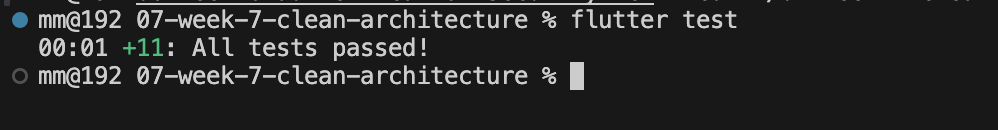

---

## 8. AI Challenge

Prompt (diadaptasi ke project Week 5), output awal AI, tabel usulan-vs-keputusan-final, checklist verifikasi, dan hasil tiga grep terdokumentasi pada [docs/ai_challenge.md](./docs/ai_challenge.md).

---

## 9. Bukti Visual (Screenshot Before/After)

Behavior wajib identik sebelum dan sesudah refactor. Screenshot "before" diambil dari aplikasi Week 5 (UI identik karena refactor tidak mengubah tampilan); "after" diambil dari aplikasi hasil refactor pada emulator Android (720×1280).

| Layar                        |                        Before                        |                       After                        |
| :--------------------------- | :--------------------------------------------------: | :------------------------------------------------: |
| Daftar Catatan (offline)     |     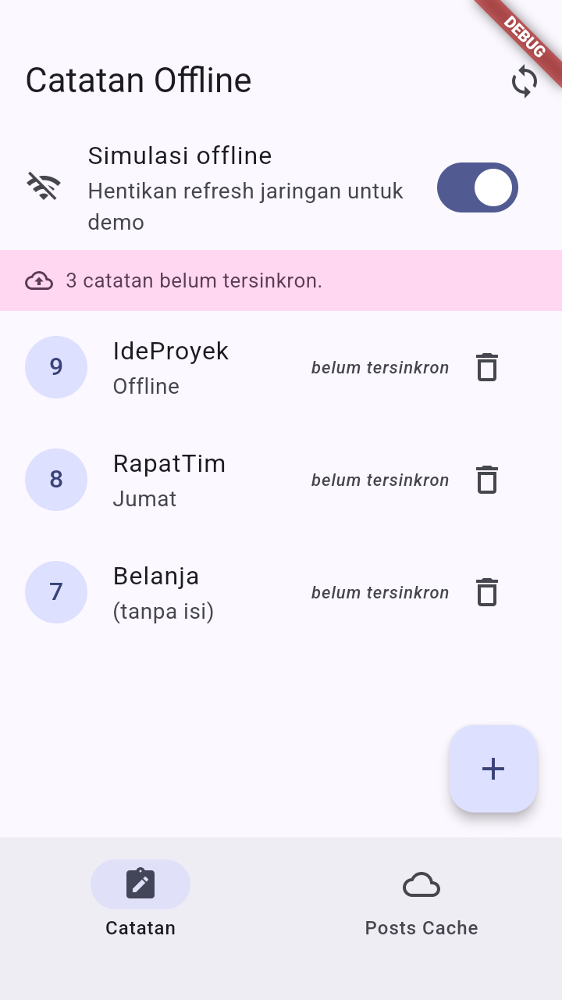     |     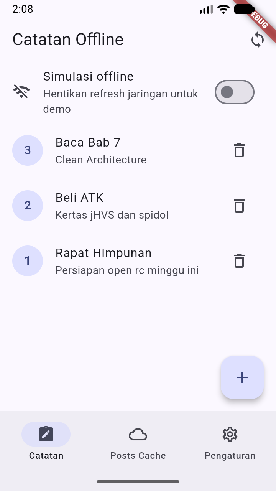     |
| Badge dirty sebelum sync     | 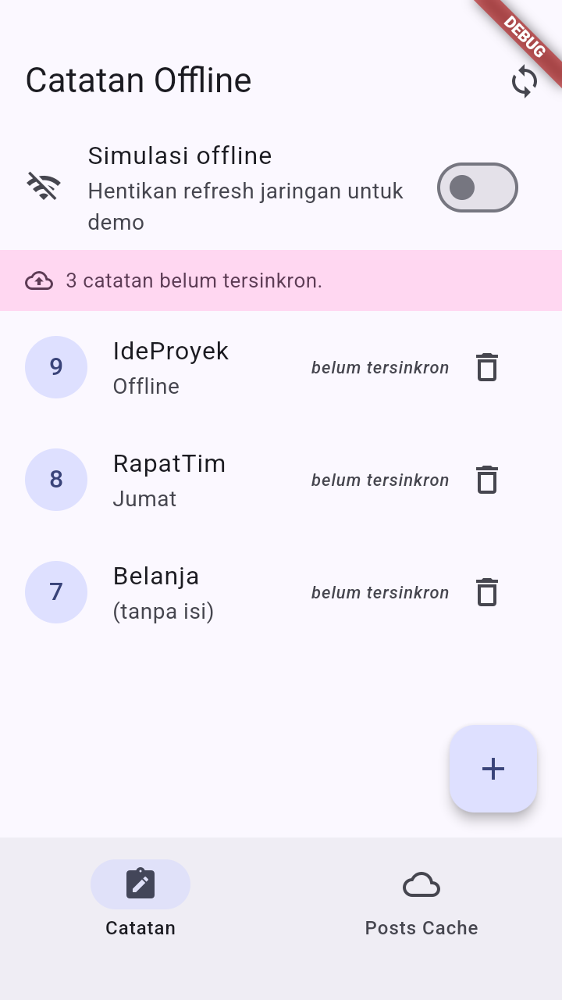  | 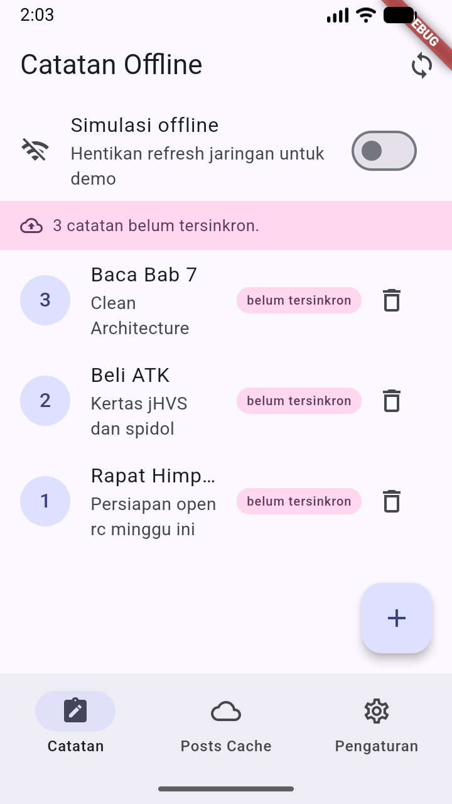  |
| Badge dirty sesudah sync     |  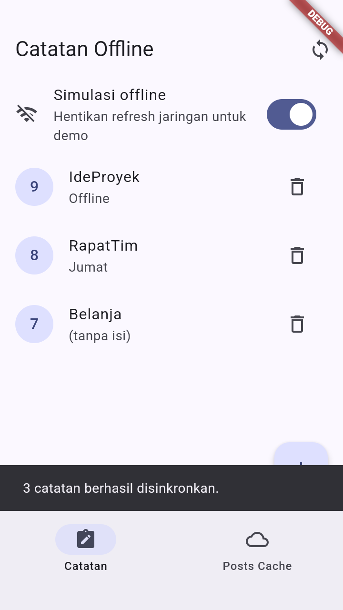  |  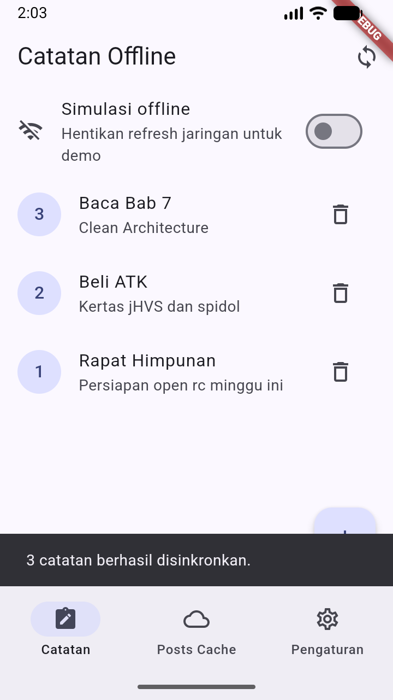  |
| Cache Posts (offline)        |     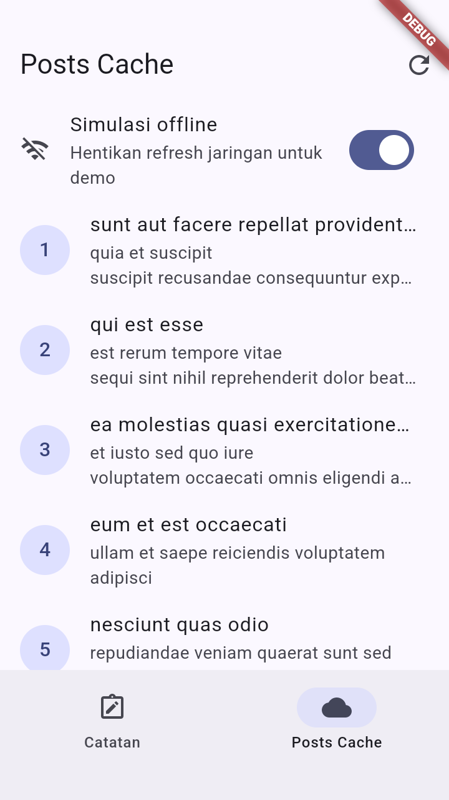     |     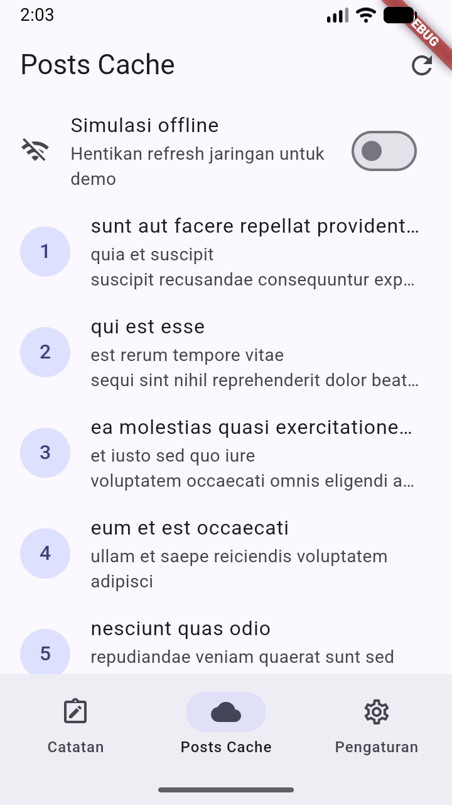     |
| Detail Catatan (`/note/:id`) |    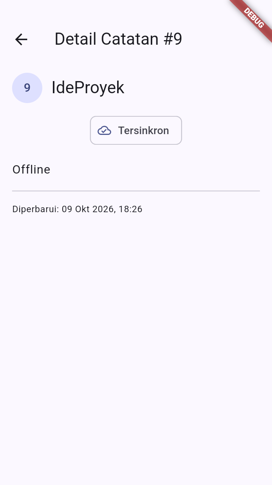     |    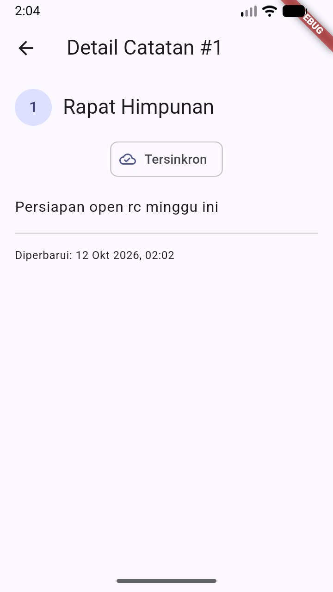     |
| Pengaturan                   |   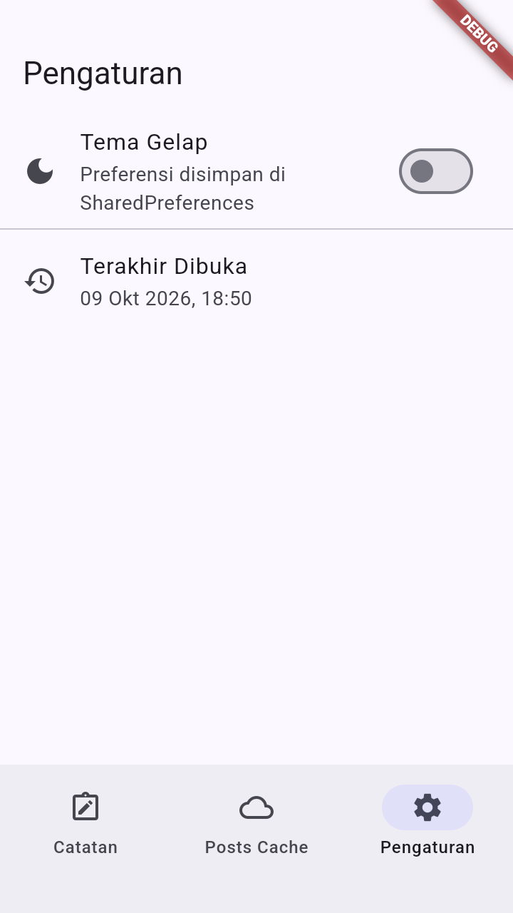    |   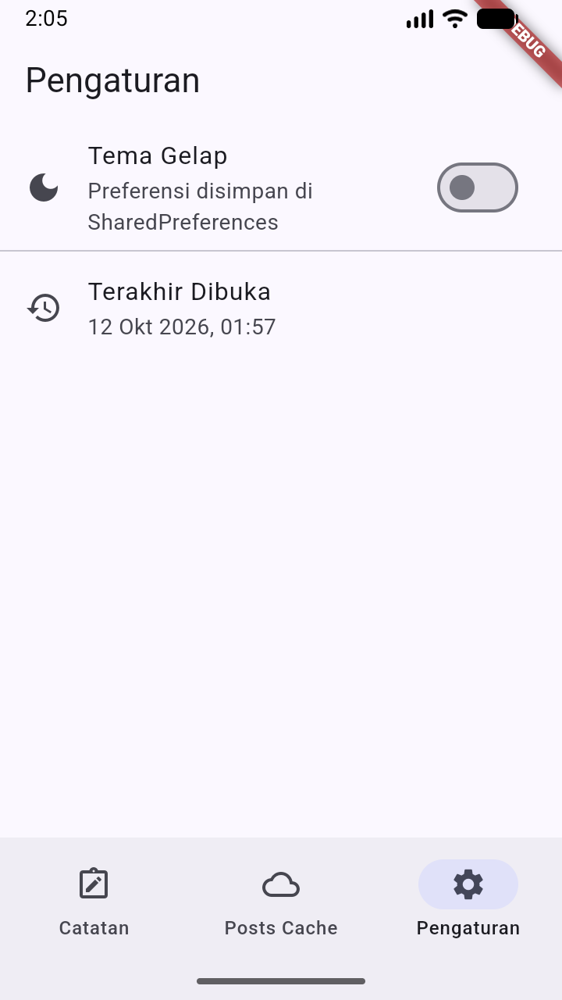    |
| Pengaturan (tema gelap)      | 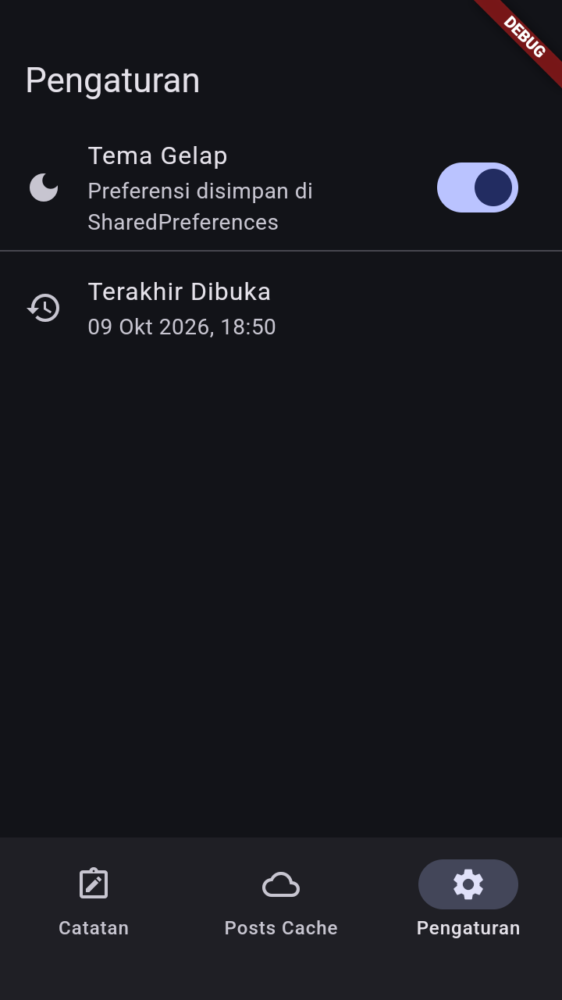 | 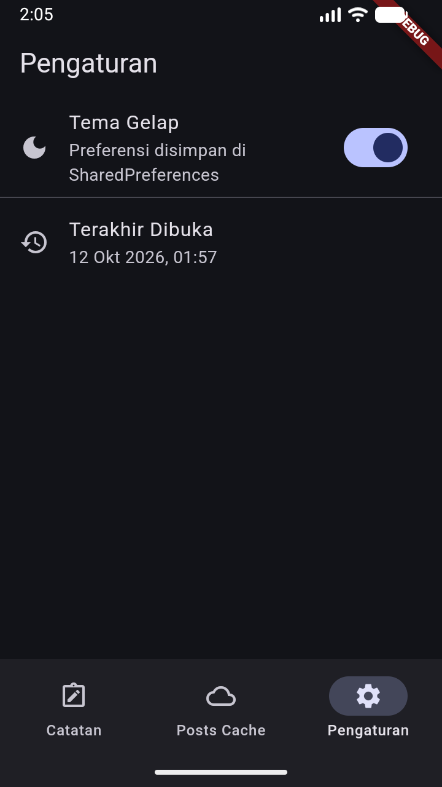 |

> Catatan: banner `DEBUG` muncul karena dijalankan dalam mode debug.

---

## 10. Refleksi

1. **Mengapa interface repository harus tinggal di domain, bukan di data?**
   Karena domain adalah pemilik aturan bisnis dan tidak boleh bergantung pada detail teknologi. Bila interface ditaruh di data, arah dependensi terbalik: domain (atau presentation) harus mengimpor data untuk mengetahui kontraknya. Akibatnya domain tidak lagi bisa diuji murni dan penggantian sumber data (SQLite → REST) memaksa perubahan di domain. Dengan interface di domain, data yang menyesuaikan diri ke domain.

2. **Kapan use case benar-benar dibutuhkan, dan kapan repository langsung ke notifier sudah cukup?**
   Use case diperlukan saat operasi menggabungkan lebih dari satu repository/langkah atau mengandung aturan bisnis (validasi, sorting, sync). Contoh di sini: `SyncNotes` (hitung dirty → kirim → tandai tersinkron). Untuk CRUD satu-baris (`addNote`, `deleteNote`), notifier memanggil repository langsung.

3. **Apa biaya over-engineering (use case per CRUD satu-baris) bagi tim kecil? Kapan biayanya sepadan?**
   Biayanya: lapisan file tambahan tanpa nilai, lebih banyak kode untuk dibaca dan diubah, serta dua tempat yang harus dijaga setiap kali field berubah. Untuk tim kecil dan CRUD sederhana, ini memperlambat tanpa menambah kualitas. Biaya baru sepadan ketika operasi tumbuh (orkestrasi multi-sumber, aturan bisnis, atau kebutuhan pengujian terisolasi yang tinggi).

4. **Bagian mana dari usulan AI yang Anda tolak atau sederhanakan, dan mengapa?**
   Saya menolak pembuatan use case untuk **setiap** operasi (termasuk CRUD satu-baris) dan penggunaan satu `AppRepository` raksasa; keduanya over-engineering untuk aplikasi ini. Saya juga menolak penambahan package DI (`get_it`) karena provider Riverpod sudah cukup. Saya menyederhanakan usulan pemisahan `data/` global menjadi `lib/shared/data/` hanya untuk infrastruktur lintas fitur (satu file database, satu klien Dio). Rincian ada di [docs/ai_challenge.md](./docs/ai_challenge.md).

---

## 11. Jurnal Belajar

### Ringkasan Teknis

- **Dependency rule**: dependensi hanya mengarah ke dalam (`presentation → domain ← data`); `domain` bebas framework.
- **Entity vs model**: `Note`/`Post` murni di domain; mapping (`toMap`/`fromJson`/`toEntity`) hanya di `*_model.dart`.
- **Repository interface vs impl**: kontrak di `domain/repositories`, implementasi di `data/repositories`, `openDb` disuntikkan.
- **Use case selektif**: `GetNotes` dan `SyncNotes`; CRUD satu-baris lewat repository langsung.
- **DI Riverpod**: wiring terpusat di `presentation/providers`; `main` memakai `ProviderContainer` sehingga tidak ada instansiasi manual repository.
- **Failure ramah pengguna**: exception data layer dikonversi ke `LocalFailure`/`NetworkFailure` sebelum ke UI.
- **Fungsi murni**: `core/format.dart` menyatukan formatting tanggal & parsing rute agar teruji tanpa widget.

### Kendala

1. **Import cycle `routes.dart` ↔ halaman.** Menaruh konstanta rute dan konfigurasi `GoRouter` dalam satu file membuat halaman harus mengimpor file yang juga mengimpor halaman. **Solusi**: konstanta rute murni dipindah ke `lib/core/routes.dart`, sedangkan `GoRouter` tetap di `lib/routes.dart`.
2. **Lint `prefer_initializing_formals`.** Repository memakai field privat (`_openDb`) dengan parameter bernama `openDb`, yang tidak bisa memakai initializing formal untuk nama privat. **Solusi**: field dibuat publik (`openDb`, `dio`) sehingga `this.openDb`/`this.dio` valid.
3. **`lib/core` harus tetap steril.** Provider lintas fitur bergantung pada Riverpod, sedangkan grep sterilitas menyertakan `lib/core`. **Solusi**: provider lintas fitur dan infrastruktur bersama diletakkan di `lib/shared/`, bukan `lib/core/`.
4. **Satu file database untuk dua fitur.** Tabel `notes` dan `cached_posts` berada di database yang sama. **Solusi**: `openAppDb()` di `lib/shared/data/` disuntikkan ke kedua repository sehingga tidak ada fitur yang mengimpor data fitur lain.

---

## 12. Kesimpulan

Project Minggu 5 berhasil direfactor menjadi **Clean Architecture feature-first** pada folder `07-week-7-clean-architecture/`. Tiga fitur (`notes`, `posts`, `settings`) terpisah menjadi layer `domain`/`data`/`presentation`; entity bersih dari mapping; interface repository tinggal di domain dan implementasinya di data; use case dipakai selektif; dan DI terpusat lewat Riverpod. Dependency rule terbukti lewat **tiga grep sterilitas yang nol hasil**, `flutter analyze` bersih, dan **11 tes lulus** dengan repository palsu. Perilaku aplikasi identik sebelum dan sesudah refactor (dibuktikan screenshot before/after).
